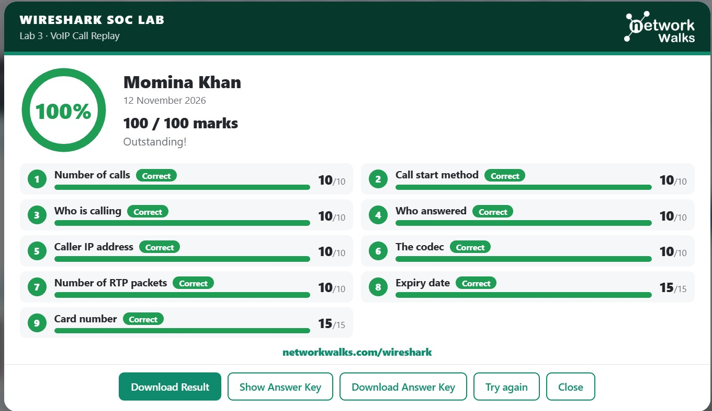
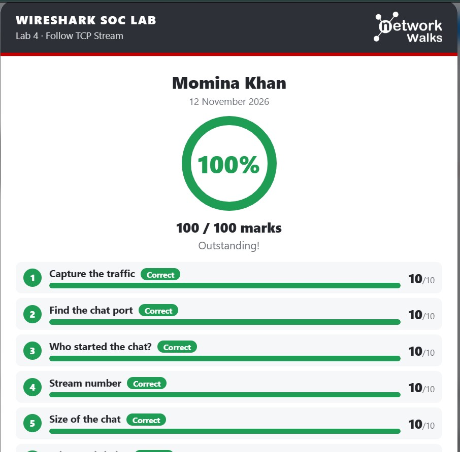
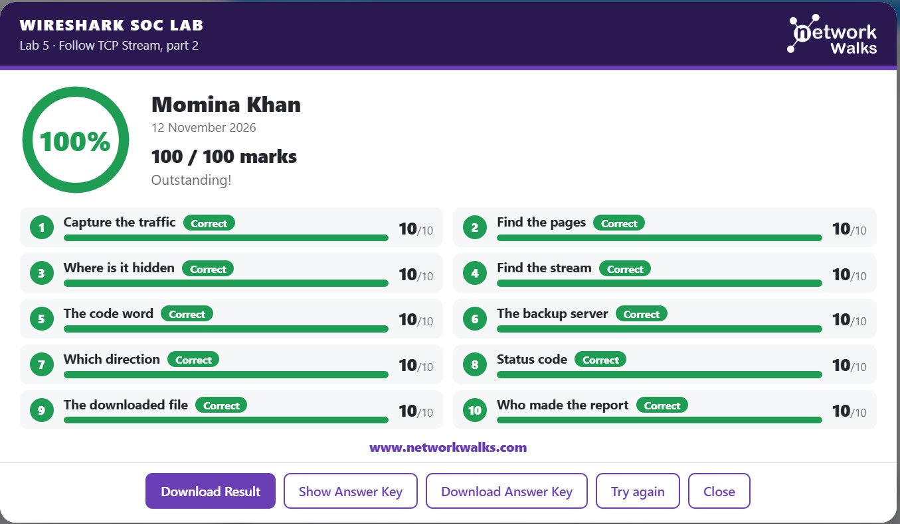
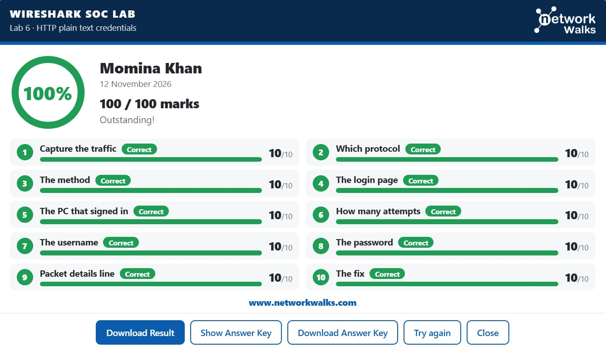
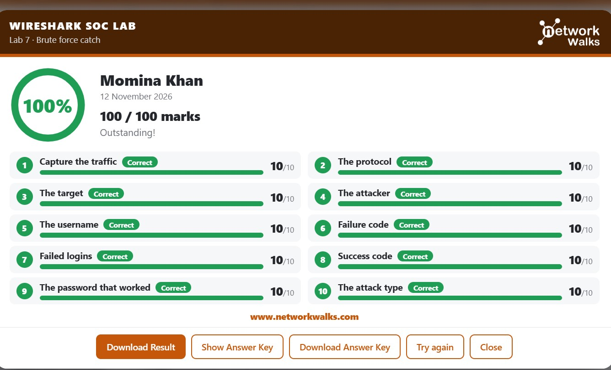
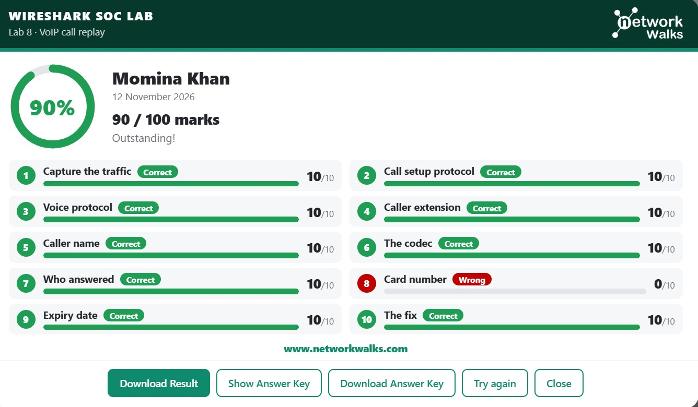

# Networkwalks-Momina-B084-week1-Wireshark
## WIRESHARK SOC LAB
# Networkwalks Wireshark SOC Labs & Packet Analysis

**Security Operations Centre (SOC) | Network Traffic Inspection | Digital Forensics**

| Repository Detail | Information |
| :--- | :--- |
| **Security Analyst** | Momina Khan |
| **Focus Area** | Practical Wireshark investigation, stream reconstruction, and threat detection |
| **Scope** | Six structured SOC labs covering sixty total hands-on traffic analysis tasks |

---

## Ethical & Security Notice

All technical procedures, packet captures, and analytical workflows documented in this repository were performed strictly for educational training, skill development, and portfolio demonstration within authorised lab parameters. No sensitive credentials, proprietary data, or unauthorised network probes are published here.

---

## Project Overview

This repository outlines my completion of the extra Networkwalks Wireshark SOC project modules. Across six distinct lab exercises, I utilized Wireshark to inspect packet captures, trace suspicious network connections, and analyze clear-text protocol behavior. 

The primary goal of this work is to build a structured, methodical approach to network traffic analysis (NTA) and incident investigation.

---

## Core Objectives

* Build proficiency in navigating and filtering packet captures (`PCAPs`) using Wireshark.
* Trace and identify suspicious source IP addresses responsible for specific network events.
* Reconstruct full TCP conversations to examine underlying application payloads.
* Analyze unencrypted HTTP traffic to understand the risks of transmitting clear-text credentials.
* Recognize repeated authentication patterns indicative of automated brute-force attacks.
* Inspect specialized communication captures to uncover indicators of scam activity.
* Maintain clear, professional technical documentation for security analysis portfolios.

---

## Toolkit & Environment

* **Primary Tool:** Wireshark (Packet analysis and protocol inspection)
* **Analysis Techniques:** TCP stream reconstruction, HTTP payload inspection, authentication log analysis
* **Data Sources:** Structured educational PCAP files provided through the Networkwalks lab track

---

## Lab Breakdown & Practical Focus

| Lab ID | Lab Title | Tasks | Core Investigation Focus |
| :---: | :--- | :---: | :--- |
| **Lab 3** | VoIP Call Replay[cite: 14] | 10 | Investigating call parameters, codecs, and transaction artifacts. |
| **Lab 4** | Follow TCP Stream[cite: 15] | 10 | Reconstructing bidirectional chat streams and analyzing payload size. |
| **Lab 5** | Follow TCP Stream, Part 2[cite: 16] | 10 | Extracting hidden data elements, backup server paths, and download files. |
| **Lab 6** | HTTP Plain Text Credentials[cite: 17] | 10 | Inspecting unencrypted web traffic to demonstrate clear-text credential leaks. |
| **Lab 7** | Brute Force Catch[cite: 18] | 10 | Spotting repetitive login request patterns and identifying attack types. |
| **Lab 8** | VoIP Call Replay[cite: 19] | 10 | Analyzing voice protocol call setups, extensions, and metadata verification. |

---

## Official Lab Scorecards & Results

Below are the official completion scorecards verifying my lab results and marks achieved across the Networkwalks SOC modules:

| Lab 3: VoIP Call Replay (100%)[cite: 14] | Lab 4: Follow TCP Stream (100%)[cite: 15] |
| :---: | :---: |
| [cite: 14] | [cite: 15] |

| Lab 5: TCP Stream Part 2 (100%)[cite: 16] | Lab 6: HTTP Plain Text (100%)[cite: 17] |
| :---: | :---: |
| [cite: 16] | [cite: 17] |

| Lab 7: Brute Force Catch (100%)[cite: 18] | Lab 8: VoIP Call Replay (90%)[cite: 19] |
| :---: | :---: |
| [cite: 18] | [cite: 19] |

---

## Author
* Momina Khan
* Cybersecurity and Digital Forensics Student | Batch B084
* LinkedIn: https://www.linkedin.com/in/momina-khan-5793453aa/
